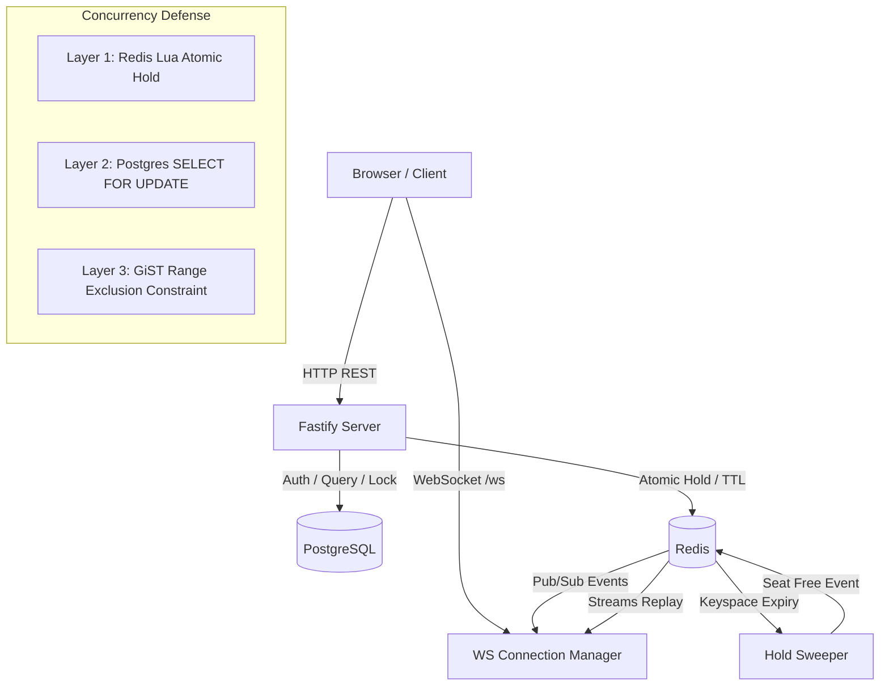

# RailBook

> An IRCTC-style railway ticket booking backend powered by segment-based seat allocation and bitmask concurrency control.

## What It Does

- **Segment-Based Seat Allocation**: Optimizes seat utilization across intermediate stations using bitmask operations.
- **Atomic Seat Holds**: Temporarily reserves seats for 5 minutes via Redis Lua scripts with automatic TTL expiry and sweeper notifications.
- **Double-Booking Prevention**: Three-tier concurrency control combining Redis Lua holds, PostgreSQL row-level locks (`SELECT ... FOR UPDATE`), and PostgreSQL exclusion constraints (`EXCLUDE USING gist`).
- **Real-Time Seat Maps**: Live seat availability updates over WebSockets with heartbeat ping/pong and Redis Streams reconnect replay.
- **Multi-Instance Sync**: Cross-instance real-time synchronization through Redis Pub/Sub.
- **Simulated Payment & Idempotency**: Idempotent booking confirmation with simulated payment processing and instant seat release on cancellation.

## How It Works

A train journey consists of ordered stations. The track between any two consecutive stations forms a **segment**. A booking from station index $i$ to $j$ occupies segments $[i, j - 1]$, represented as a bitmask where bit $k$ is set if segment $k$ is occupied.

A seat is available for a journey if:

$$\text{occupiedMask} \ \& \ \text{journeyMask} = 0$$

### Example (Route: A → B → C → D → E)

| Station | Index | Segment | Bit |
|---------|-------|---------|-----|
| A → B   | 0 → 1 | Seg 0   | `0001` (1) |
| B → C   | 1 → 2 | Seg 1   | `0010` (2) |
| C → D   | 2 → 3 | Seg 2   | `0100` (4) |
| D → E   | 3 → 4 | Seg 3   | `1000` (8) |

1. **Passenger 1 books A → C**: Occupies Seg 0 and Seg 1.  
   $\text{Mask} = \mathtt{0011}_2\ (3)$.
2. **Passenger 2 requests C → E**: Requires Seg 2 and Seg 3.  
   $\text{Mask} = \mathtt{1100}_2\ (12)$.  
   $\mathtt{0011}_2\ \&\ \mathtt{1100}_2 = 0 \implies$ **Allowed**. The same seat serves both passengers.
3. **Passenger 3 requests B → D**: Requires Seg 1 and Seg 2.  
   $\text{Mask} = \mathtt{0110}_2\ (6)$.  
   $\mathtt{0011}_2\ \&\ \mathtt{0110}_2 = \mathtt{0010}_2 \ne 0 \implies$ **Rejected**. Overlaps on segment B → C.

## Architecture Diagram



Incoming booking requests pass through three strict layers of concurrency defense:
1. **Redis Lua Script**: Performs an atomic check-and-set hold with TTL, preventing multiple users from holding overlapping segments.
2. **PostgreSQL Row Locking**: During confirmation, executes `SELECT ... FOR UPDATE` on `seat_availability` within an ACID transaction.
3. **PostgreSQL GiST Exclusion Constraint**: The `int4range(from_index, to_index) WITH &&` constraint guarantees the database rejects overlapping segments even under race conditions.

## Tech Stack

- **Runtime & Language**: Node.js 20, TypeScript
- **Web Framework**: Fastify
- **Database**: PostgreSQL (`pg`) with `btree_gist` extension
- **Cache & Messaging**: Redis (`ioredis`) for Lua scripts, Pub/Sub, and Streams
- **WebSockets**: `ws`
- **Testing**: Vitest, TSX
- **Authentication**: JWT (`@fastify/jwt`) with `bcryptjs`

## API Endpoints

| Method | Endpoint | Auth | Description |
|--------|----------|------|-------------|
| `POST` | `/auth/register` | No | Register a new user |
| `POST` | `/auth/login` | No | Login and receive JWT |
| `GET` | `/health` | No | Health check and server status |
| `GET` | `/trains?from=&to=&date=` | No | Search trains with available seat counts |
| `GET` | `/trains/:id/seats?date=&from=&to=` | No | Get seat map with seat status (`free`, `held`, `booked`) |
| `POST` | `/holds` | Yes | Hold a seat for 5 minutes via atomic Lua script |
| `DELETE` | `/holds/:id` | Yes | Release a held seat |
| `POST` | `/bookings` | Yes | Confirm booking with simulated payment & idempotency key |
| `POST` | `/bookings/:id/cancel` | Yes | Cancel booking and release occupied segments |
| `GET` | `/bookings/me` | Yes | List current user's booking history |
| `WS` | `/ws` | No | WebSocket for live seat updates (`subscribe`, `resume`, `seat_update`) |

## Getting Started

### Prerequisites

- Node.js 20+
- PostgreSQL running on `localhost:5432`
- Redis running on `localhost:6379`

### Setup

1. Clone the repository and install dependencies:
   ```bash
   npm install
   ```

2. Configure environment variables:
   ```bash
   cp .env.example .env
   ```

3. Initialize database schema and seed data (2 trains, 6 stations each, 3 coaches x 40 seats, 7 travel dates):
   ```bash
   npm run setup
   ```

### Run

- **Development server**:
  ```bash
  npm run dev
  ```
- **Production build**:
  ```bash
  npm run build
  npm start
  ```
- Access the live seat map UI at: `http://localhost:3000/index.html`

### Test

- **Unit tests** (bitmask segment logic):
  ```bash
  npm run test:unit
  ```
- **Integration tests** (auth, search, hold, book, cancel, overlapping segments):
  ```bash
  npm run test:integration
  ```
- **All tests**:
  ```bash
  npm test
  ```
- **Concurrency load test** (20 parallel requests racing for the same seat):
  ```bash
  npm run load-test
  ```

## Project Structure

```
booking-system/
├── public/
│   └── index.html             # Live seat map web application
├── src/
│   ├── routes/
│   │   ├── auth.ts            # Register and login endpoints
│   │   ├── bookings.ts        # Booking confirmation and cancellation
│   │   ├── holds.ts           # Atomic hold creation, release, and sweeper
│   │   └── trains.ts          # Train search and seat map queries
│   ├── app.ts                 # Fastify app setup and server lifecycle
│   ├── bitmask.ts             # Bitmask calculations for segment overlap
│   ├── config.ts              # Configuration loader
│   ├── db.ts                  # PostgreSQL connection pool
│   ├── events.ts              # Redis Pub/Sub and Streams event bus
│   ├── redis.ts               # Redis client instances
│   ├── schema.sql             # PostgreSQL schema with GiST exclusion constraint
│   ├── seed.sql               # Seed data for trains, stations, seats, dates
│   ├── setup.ts               # Database initialization runner
│   └── ws.ts                  # WebSocket server and heartbeat manager
├── tests/
│   ├── bitmask.test.ts        # Unit tests for bitmask logic
│   ├── integration.test.ts    # End-to-end API integration tests
│   └── load-test.ts           # Concurrency stress test for race conditions
├── .env.example               # Environment variables template
├── .gitignore                 # Git ignore configuration
├── package.json               # Dependencies and scripts
├── tsconfig.json              # TypeScript configuration
├── vitest.config.mts          # Vitest configuration
└── README.md                  # Project documentation
```
